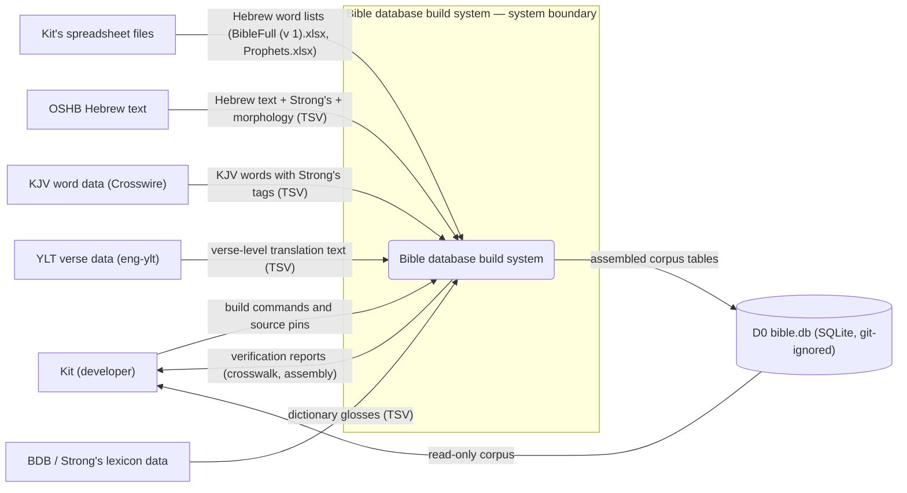
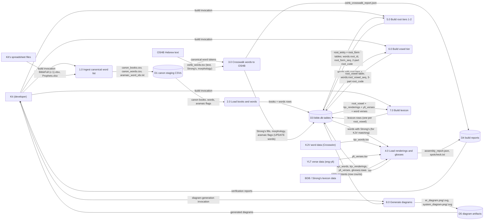
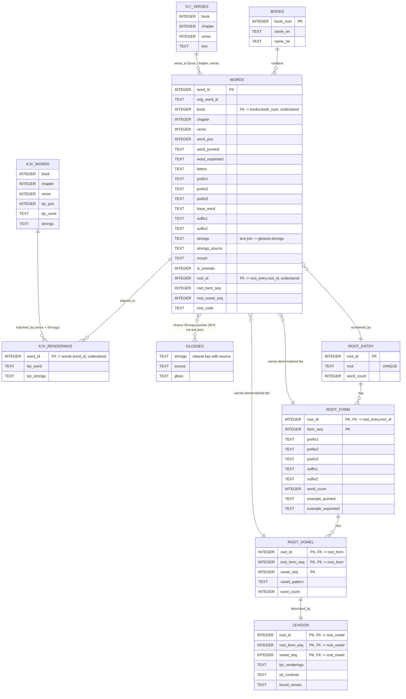

Living document — update these diagrams when adding features.

# Bible — Architecture

**FROZEN / SUPERSEDED — read this first.** This repo is an earlier, superseded partial copy of the Bible Project. The GitHub repo description states verbatim: "Earlier partial Bible-database copy; current work continues in the bible-project repository." It is not archived, but no code, schema, or data changes have landed since the 2026-09-21 build (final build files committed 2026-09-22T03:12:22Z as `937d5bae`; only `docs/architecture.md` changed after that); the live continuation is `bible-project` (U-8/U-9 repairs, YLT word alignment, the Flask website). Do not describe live-system features (the reader website, build-your-own-translation tooling, word-level YLT) as if they existed here — this repo has no website code, no user tables, and YLT data is verse-level only.

A sharp observed detail: the build scripts as committed still hardcode their working paths to the live project's tree — `ROOT = '/home/hatch/workspace/bible-project'` in `assemble_bible.py` and `build_roots.py`; `DB = '/home/hatch/workspace/bible-project/bible.db'` in `build_roots2.py`, `build_roots3.py`, `build_lexicon.py`; and `OUT = '/home/hatch/workspace/bible-project/worker-out/canon'` in `ingest_canonical.py`, `fixup_notes.py`, `diff_corrected.py`. This repo is a code snapshot of the 2026-09-20/21 build; it does not build a database inside itself as-is.

**Repo inventory (observed, recursive tree, 24 entries):** `.gitignore`, `LICENSE`, `NOTATION_LEDGER.md`, `README.md`, `assemble_bible.py`, `assembly_report.json`, `build_lexicon.py`, `build_roots.py`, `build_roots2.py`, `build_roots3.py`, `diagrams.py`, `diff_corrected.py`, `er.py`, `er_diagram.png`, `er_diagram.svg`, `fixup_notes.py`, `ingest_canonical.py`, `oshb_crosswalk_report.json`, `spotcheck.txt`, `sys.py`, `system_diagram.png`, `system_diagram.svg`, plus `docs/` (directory) and `docs/architecture.md`. No subdirectories other than `docs/`; no website code; no `bible.db` (git-ignored build artifact).

**Shipped diagrams are aspirational, not as-built.** `er_diagram.png`/`.svg` and `system_diagram.png`/`.svg` are matplotlib outputs of `er.py`/`sys.py` (and the combined `diagrams.py`). The ER generator models entities that were never built in this repo: `USER`, user translations (`utrans`/`tchoice`), a `VERSE` entity with `assembled_text`, and a `NOTE` entity; it also shows a `rendering_id` PK on the KJV table and a `section` column on books — none of which appear in the actual `CREATE TABLE` statements. The ERD below is grounded in the real schema, not in those PNGs.

## 1. Context diagram (level 0)

Boundary note: the system boundary is the batch build pipeline. Everything Kit-authored or public-domain flows in from the left; the only persistent output inside the boundary is the git-ignored `bible.db`. There is no website, no API, and no second reader at this level — the sole consumer is Kit.

## 2. Level-1 data flow diagram

Processes follow the actual script invocations, in build order. (Processes 2.0–4.0 are sequential sections of the single script `assemble_bible.py`; the split is logical, not separate runs.)

Process inventory check: every process has ≥1 input and ≥1 output — no black holes, no miracles.

## 3. Entity–relationship diagram

Grounded in the actual `CREATE TABLE` statements in `assemble_bible.py` plus the `ALTER TABLE` additions in `build_roots*.py`. Tables with no declared key are shown without a PK — that is the honest schema, not an omission.

Reading notes: `KJV_RENDERINGS` is the junction entity for the M:N relationship between Hebrew words and KJV words (one Hebrew word ↔ many KJV words sharing its Strong's number in the same verse, and vice versa). `ROOT_VOWEL` and `LEXICON` are 1:1 (one lexicon row per `(root_id, root_form_seq, vowel_seq)`). Most joins in this schema are by convention, not declared: only `root_form.root_id`, `root_vowel → root_form`, and `lexicon → root_vowel` carry `REFERENCES` clauses in the DDL.

## Grounding notes

- OBSERVED (`README.md`): the 10-table inventory with exact row counts (words 264,217; kjv_renderings 409,930; kjv_words 610,324; ylt_verses 23,145; glosses 17,347; books 39; root_entry 30,087; root_form 57,724; root_vowel 126,869; lexicon 126,869); the script table; the three-tier root-based numbering `root.fix.vowel` (e.g. `19247.42.1`); the public-domain source list (Kit's spreadsheets, OSHB/morphhb, Crosswire KJV, eng-ylt USFM, Open Scriptures HebrewLexicon); "Database built; website not yet started". **Correction to the previous doc:** it said 11 tables; the README and the DDL show exactly 10.
- OBSERVED (`assemble_bible.py`): the six `CREATE TABLE` statements (books, words, kjv_words, kjv_renderings, ylt_verses, glosses) with the exact column names and types used in the ERD; the five indexes; the build sections in order (canon load → OSHB crosswalk → KJV → YLT → glosses → verification → spotcheck → assembly report). The ERD's PK/FK honesty follows the DDL: `kjv_words`, `kjv_renderings`, `ylt_verses`, `glosses` declare no primary key; the `words → books`, `words → glosses`, `kjv_renderings → words` joins are by convention only.
- OBSERVED (`build_roots.py`, `build_roots2.py`): `root_entry(root_id PK, root UNIQUE, word_count)` and `root_form(root_id, form_seq, prefix1..3, suffix1..2, word_count, example_pointed, example_unpointed)` with `PRIMARY KEY(root_id, form_seq)` and declared `REFERENCES root_entry(root_id)`; the `ALTER TABLE words ADD COLUMN root_id/root_form_seq/root_code`; the 105 Kit/OSHB Strong's conflict flips to OSHB.
- OBSERVED (`build_roots3.py`): `root_vowel(root_id, root_form_seq, vowel_seq, vowel_pattern, word_count)` with three-part PK and declared FK to `root_form`; `words.root_vowel_seq` added and `root_code` rewritten to three-part form.
- OBSERVED (`build_lexicon.py`): `lexicon(root_id, root_form_seq, vowel_seq PK, kjv_renderings, ylt_contexts, found_verses TEXT)` with declared FK to `root_vowel`; KJV renderings ordered by frequency then alphabetically; YLT column honestly carries verse-level texts (U-1), not per-word glosses.
- OBSERVED (`ingest_canonical.py`): reads `BibleFull (v 1).xlsx` and `Prophets.xlsx` (both `.xlsx`; no `.ods` file is read by any committed script, though the README's source list names `Prophets.ods`/`Verses.ods`); writes staging CSVs to `worker-out/canon/`. OBSERVED (`fixup_notes.py`, `diff_corrected.py`): one-off cleaning passes — Sheet1 notes mapped to canonical words deriving the Aramaic flags; corrected diff of Prophets sheets against canon words.
- OBSERVED (`er.py`, `sys.py`, `diagrams.py` + shipped PNG/SVG artifacts): the diagram generators and their aspirational content — `USER`, user-translation entities (`utrans`, `tchoice`), a `VERSE` entity, a `NOTE` entity, `rendering_id` PK on KJV, `section` on books — none of which exist in the DDL. The ERD above deliberately does not reproduce them.
- OBSERVED (repo tree + `.gitignore`): `bible.db` is git-ignored (rebuild artifact); `assembly_report.json`, `oshb_crosswalk_report.json`, `spotcheck.txt` are committed build reports.
- OBSERVED (GitHub repo metadata): description "Earlier partial Bible-database copy; current work continues in the bible-project repository."; created 2026-09-21; default branch `main`; not archived.
- INFERRED: processes 2.0–4.0 are drawn as separate DFD processes but are sequential sections of the single `assemble_bible.py` run — the decomposition follows the script's own section order, which is also the README's "crosswalk to OSHB, KJV/YLT/gloss loading, SQLite build" decomposition.
- INFERRED: the internal wiring of `fixup_notes.py`/`diff_corrected.py` into the canon CSVs (D1) — both read the spreadsheet/canonical files and contribute the Aramaic flags and the Prophets diff; their exact contribution boundaries are inferred from their docstrings and outputs.
- INFERRED: D5's contents are read by Kit from the repo (the committed PNG/SVG files); no downstream consumer beyond Kit was observed.

## Currency

Current as of 2026-09-28. The only commit since 2026-09-28T00:00:00Z is `08e92d73` ("docs: add SAD architecture doc") — this doc's predecessor. No code, schema, or data changes since the 2026-09-20/21 build. The repo remains frozen and superseded by `bible-project`.

## Open uncertainties

- The script docstrings and paths reference `~/workspace/bible-project` (the live project). It is unobserved whether the live project still has those exact worker-out files in place; this repo cannot verify that.
- `NOTATION_LEDGER.md` is a living record of notation conventions and U- items; it is not wired into any build process observed here (no script reads it), so it appears only as context, not as a data flow.
- The aspirational diagram entities (users, translations, notes, assembled verses) document a planned website that this repo never started; if the website design is revived, it belongs in the `bible-project` docs, not here.
