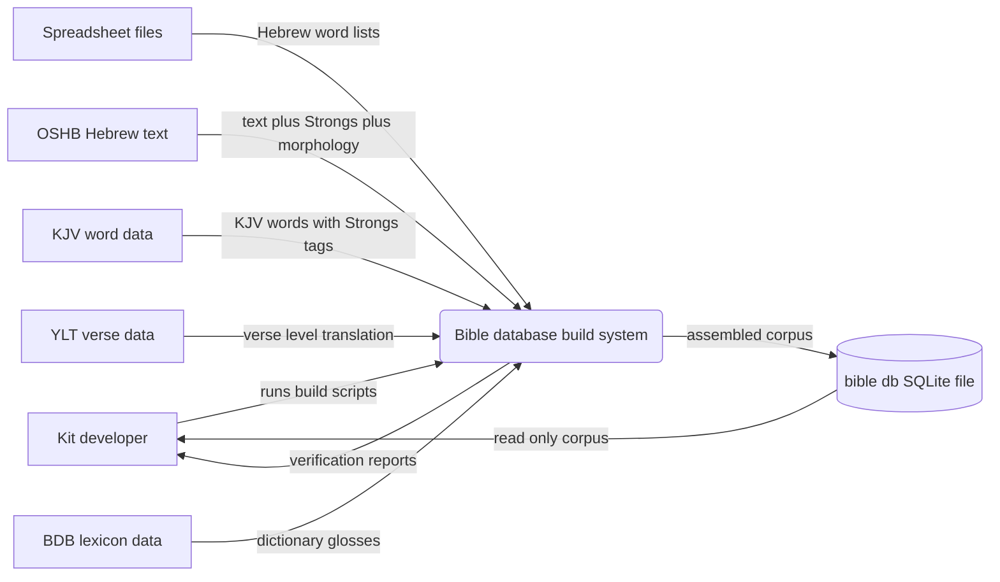
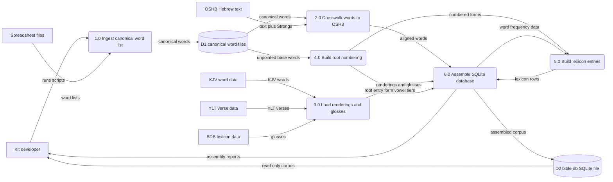
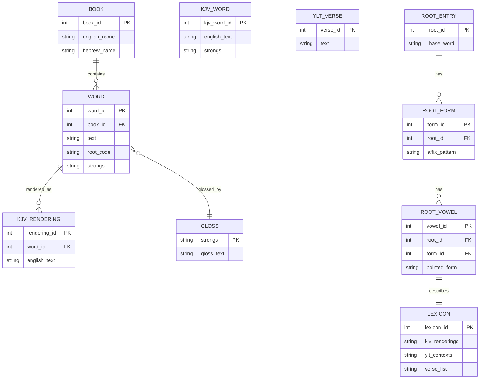

Living document — update these diagrams when adding features.

# Bible — Architecture

**Relationship to bible-project:** this repo is the earlier, superseded partial copy of the Bible Project. The repo description on GitHub states: "Earlier partial Bible-database copy; current work continues in the bible-project repository." bible-project is the live continuation (U-8/U-9 repairs, YLT word alignment, Flask website). See `bible-project/architecture.md` for the current system.

## 1. Context diagram (level 0)

## 2. Level-1 data flow diagram

## 3. Entity–relationship diagram

## Grounding notes

- Observed: README.md table of the 11 SQLite tables with exact row counts (words 264,217; kjv_renderings 409,930; kjv_words 610,324; ylt_verses 23,145; glosses 17,347; books 39; root_entry 30,087; root_form 57,724; root_vowel 126,869; lexicon 126,869); the script list (ingest_canonical.py, assemble_bible.py, build_roots.py/2/3, build_lexicon.py, fixup_notes.py, diff_corrected.py); the three-tier root-based numbering `root.fix.vowel`; public-domain source list (Kit's spreadsheets, OSHB/morphhb, Crosswire KJV, eng-ylt USFM, Open Scriptures HebrewLexicon); README status line "Database built; website not yet started".
- Observed: repo has no website/ directory and no ylt_renderings table (both present only in bible-project); no subdirectories at all — 22 files, all top-level.
- INFERRED: the internal wiring between scripts — README says assemble_bible.py does "crosswalk to OSHB, KJV/YLT/gloss loading, SQLite build" and build_roots*.py builds the tiers, so the DFD process split follows README's own decomposition but the file-level data handoffs between numbered processes are inferred from script purposes.
- INFERRED: primary/foreign keys and attribute names in the ERD are plausible column names inferred from the README's descriptions, not quoted schema (no schema file was observed in this repo); relationship cardinalities are inferred from the described one-per-word and one-per-form structure.
- INFERRED: that `bible.db` is rebuilt by the developer locally rather than shipped, from README "(SQLite, git-ignored — rebuild with assemble_bible.py)".
